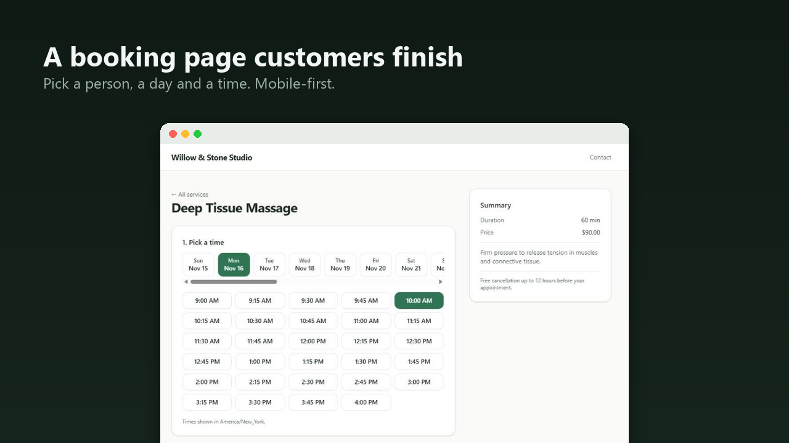
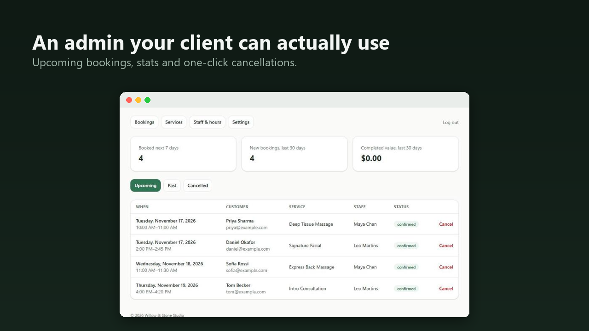

# Slotsmith Lite: open-source appointment booking for Next.js

A clean, working booking app for service businesses, built with **Next.js 15**, **TypeScript**, **Prisma**
and **Tailwind CSS v4**. Free and MIT-licensed.

Customers choose a service, a person and a time; they get a confirmation email with a private link to cancel.
The owner sees every booking in a password-protected dashboard.



## Quick start

Requirements: Node.js 20+.

```bash
npm install
cp .env.example .env        # set ADMIN_PASSWORD and AUTH_SECRET
npm run setup               # SQLite database + demo data
npm run dev
```

Open http://localhost:3000 (booking site) and http://localhost:3000/admin (dashboard).
Without SMTP settings, emails are printed to the terminal.

## What's included

- **Slot engine**: weekly hours with split shifts, buffers, minimum notice, booking horizon, time off,
  per-business timezone, DST-safe. Pure function with unit tests (`npm test`).
- **Multi-staff**: "anyone available" or a chosen person; per-service staff.
- **No double bookings**: availability is re-checked in a database transaction.
- **Emails**: confirmation, cancellation and staff notification via any SMTP provider.
- **Customer cancel link** with a configurable cutoff.
- **Admin bookings dashboard** with stats and one-click cancel.
- **SQLite** out of the box; switch to Postgres by changing the Prisma provider.

Services, staff and hours are configured in `prisma/seed.ts`.



## Lite vs Pro

| | Lite (free) | [Pro](https://steadyledgershop.gumroad.com/l/slotsmith-pro) |
|---|:---:|:---:|
| Booking flow, slot engine, multi-staff | ✅ | ✅ |
| Confirmation + cancellation emails | ✅ | ✅ |
| Admin bookings dashboard | ✅ | ✅ |
| Admin editor: services, staff, weekly hours, time off | edit `seed.ts` | ✅ |
| Settings screen (timezone, buffers, notice, currency…) | edit DB | ✅ |
| Customer self-service **reschedule** | – | ✅ |
| **Stripe deposits** with webhook + payment hold | – | ✅ |
| **24-hour reminder** emails (cron endpoint) | – | ✅ |
| Calendar invites (.ics) in emails + download | – | ✅ |
| Deploy guide (Vercel + Postgres, VPS), customization guide | – | ✅ |
| License | MIT | Commercial, unlimited client projects |

If Slotsmith saves you time, **[Slotsmith Pro](https://steadyledgershop.gumroad.com/l/slotsmith-pro)** is how you
support it.

## Project layout

```
prisma/schema.prisma      data model
prisma/seed.ts            your services, staff and hours
src/lib/slots.ts          pure slot calculator (+ tests)
src/lib/availability.ts   loads hours/bookings and calls the calculator
src/lib/bookings.ts       create and cancel bookings
src/app/book/[slug]       public booking flow
src/app/booking/[token]   customer's booking page
src/app/admin             dashboard
```

## Deploying

Any Node host works. For serverless hosts (e.g. Vercel), switch Prisma to Postgres, since SQLite files don't
persist there. Set `DATABASE_URL`, `APP_URL`, `ADMIN_PASSWORD` and `AUTH_SECRET`, then run `npx prisma db push` once.

## License

MIT. See `LICENSE`.
